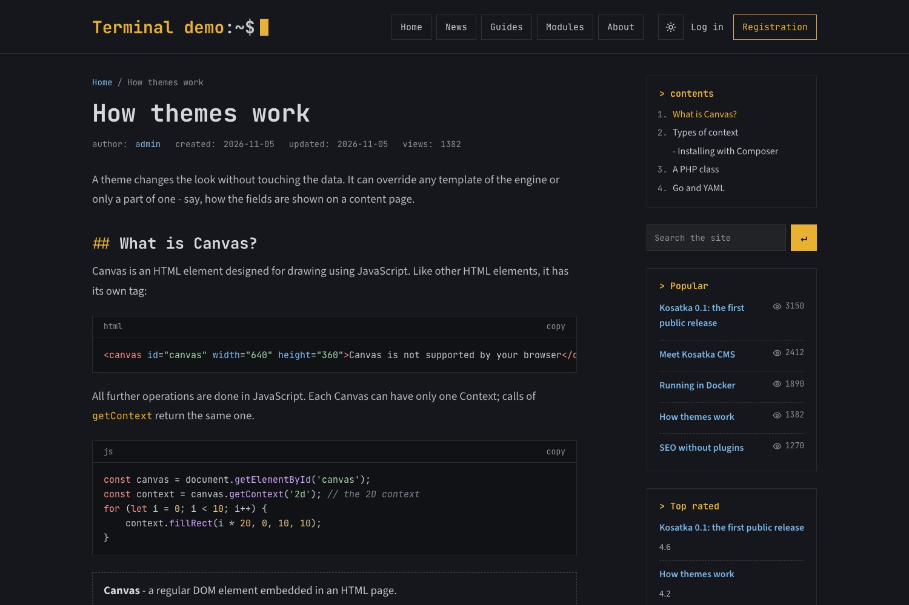
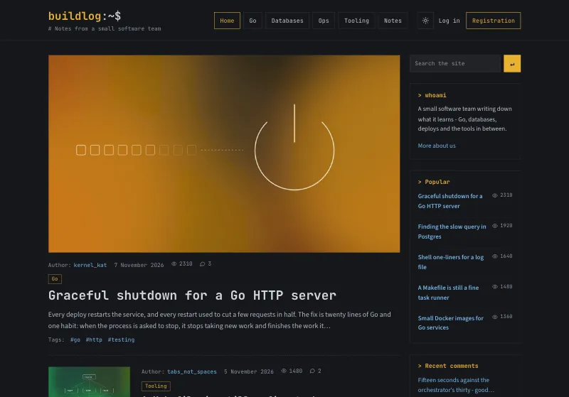
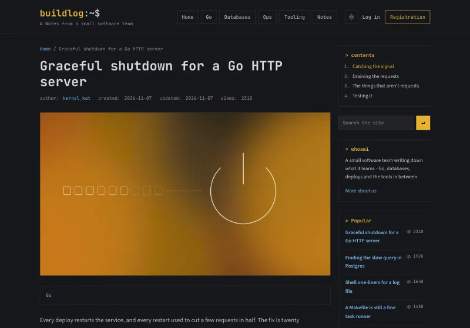
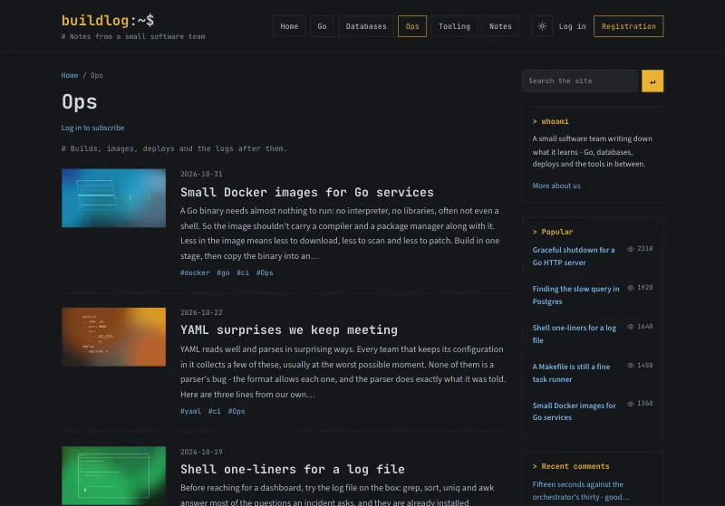
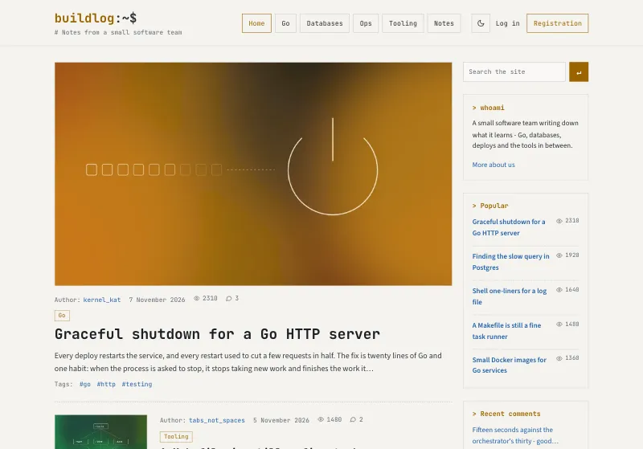
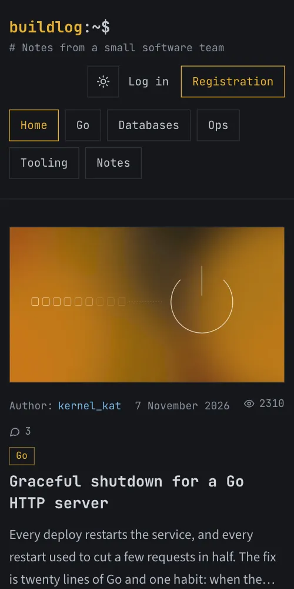
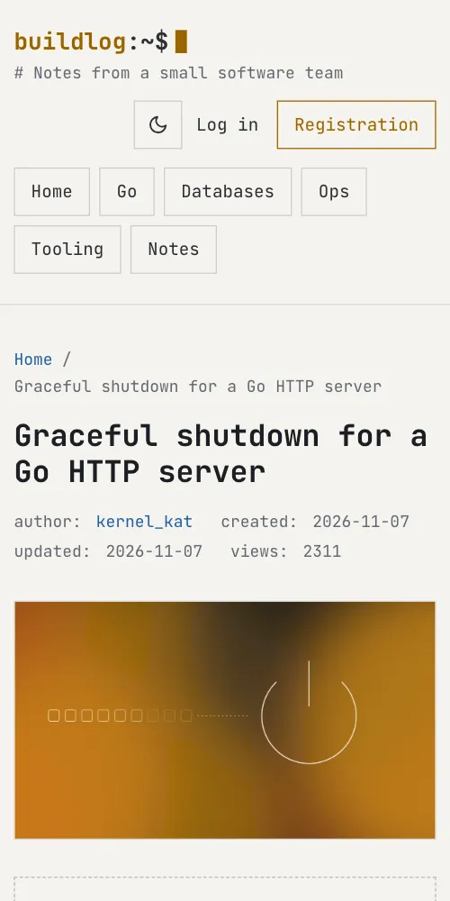

# Terminal

A theme for [Kosatka](https://github.com/kosatka-cms/kosatka): a
technical blog in a terminal. A prompt in the header, monospace
headings, dates and tags, lists in rows divided by dashed lines, code
blocks with highlighting, their language and a copy button, the contents
of a long text beside it. A palette of colours, a dark and a light
scheme.



## Screenshots

The [demo site](#a-demo-site); a picture opens the whole page.

<table>
  <tr>
    <td width="50%"><a href="docs/screenshots/home.webp"></a><br>The front page: the pinned post across, the others with a thumbnail</td>
    <td width="50%"><a href="docs/screenshots/post.webp"></a><br>A post: code with its language and a copy button, the contents beside</td>
  </tr>
  <tr>
    <td><a href="docs/screenshots/topic.webp"></a><br>A term's page</td>
    <td><a href="docs/screenshots/home-light.webp"></a><br>The light scheme</td>
  </tr>
  <tr>
    <td><a href="docs/screenshots/phone-home.webp"></a> <a href="docs/screenshots/phone-post.webp"></a><br>On a phone: the front page, a post in the light scheme</td>
    <td></td>
  </tr>
</table>

## Install

Kosatka 0.1.7 or newer.

```bash
app theme add https://github.com/kosatka-cms/kosatka-theme-terminal
```

Then commit `themes/` and choose *Terminal* on *Appearance*. See
[Distributing a theme](https://kosatka-cms.github.io/kosatka/themes/distribute/).

More themes for Kosatka: the [themes catalog](https://github.com/kosatka-cms/themes).

## A demo site

The theme comes with a demo site in English (`demo/en.yaml`):
"buildlog", the engineering notes of a small software team - posts with
code in Go, SQL, shell, Python and more, their pictures, topics and
tags, comments, a sidebar of commands. Everything in it is made up - the
team, the people and the posts; its pictures are abstract, drawn for it,
and come with the theme (`demo/images`). On a new site:

```bash
app install -site-name "buildlog" -admin-name admin -admin-email admin@example.com \
  -language en -demo-set terminal
```

Everything the demo creates is ordinary content, Views and blocks,
changed or deleted in the admin. The posts are in a text format of the
demo's own, *HTML with code*: it keeps `pre`, `code` and their `class`
(see [Code](#code)), and its editor has a code block button.

The screenshots above are of it: `python3 scripts/screenshots.py
http://127.0.0.1:8080` (the demo site's address) takes them again into
`docs/screenshots/` - Python 3 and Google Chrome are all it needs.

## Settings

On *Appearance → Terminal → Settings*:

| Setting | Default |
|---|---|
| Palette - amber, green phosphor, ice or rose | amber |
| Colour scheme by default - dark, light, or as on the visitor's device | dark |
| The text's font - proportional or monospace | proportional |
| The header's prompt | the site's name |
| The contents of a text with three headings or more | on |
| Logging in and registration in the header | on |

A visitor switches the scheme with the button in the header; the choice
is kept in the browser.

## Code

A `<pre>` in a text gets a head with its language and a copy button. The
language comes from the `class` of the `<pre>` or its `<code>`
(`language-php`, `lang-php` - what the editor's code sample writes) or
from a `data-lang` attribute. These languages are highlighted: JavaScript,
TypeScript, Go, PHP, Java, C and C++, C#, Rust, Kotlin, Swift, Python,
shell, HTML and XML, CSS, JSON, YAML, SQL, Dockerfile, INI and TOML, diff.
Another language gets its label without highlighting.

The text format of such texts keeps `pre` and `code`, and the `class`
attribute for the language (*Configuration → Text formats*).

## Regions

The engine's regions - *Header*, *Sidebar*, *Content top*, *Content
bottom*, *Inside content*, *Footer*, *Footer bottom line* - so blocks
placed for another theme stay where they are. A new site gets the
copyright block and a "Powered by Kosatka CMS" block in *Footer bottom
line*; both are ordinary blocks to change or remove on *Blocks*. A
block's title in the sidebar
is shown as a command: `> title`.

## Fonts

JetBrains Mono for the prompt, headings, dates and code, Source Sans 3
for the text, both with Latin, Cyrillic and Greek. They come with the
theme (`static/fonts`, SIL Open Font License 1.1) and the site serves
them: no requests to other servers.

## Translations

The theme's own strings: English, Russian, German and Spanish
(`translations/`).

## License

MIT
